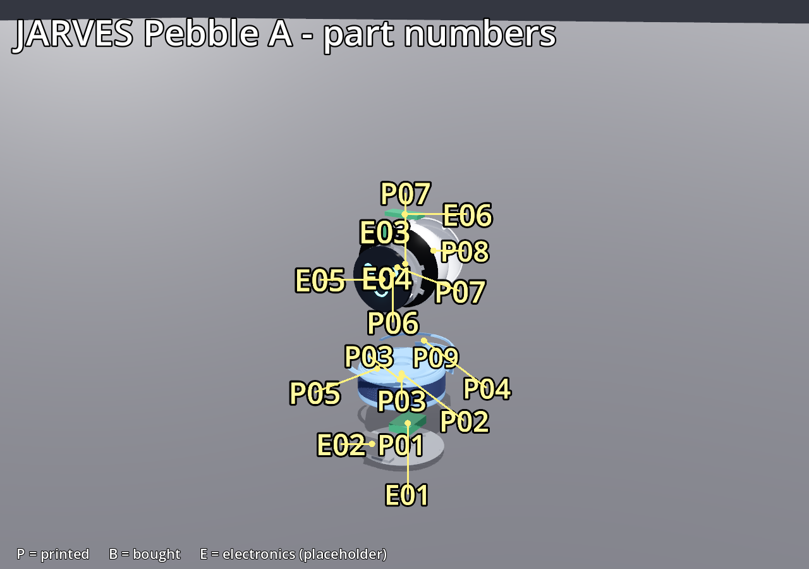
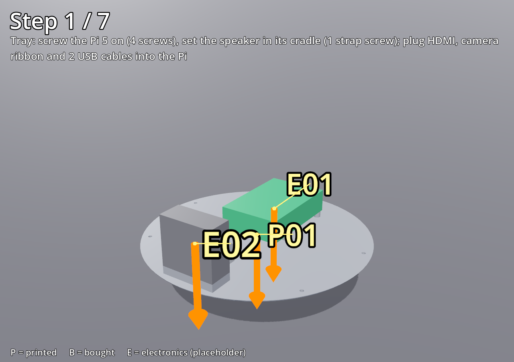
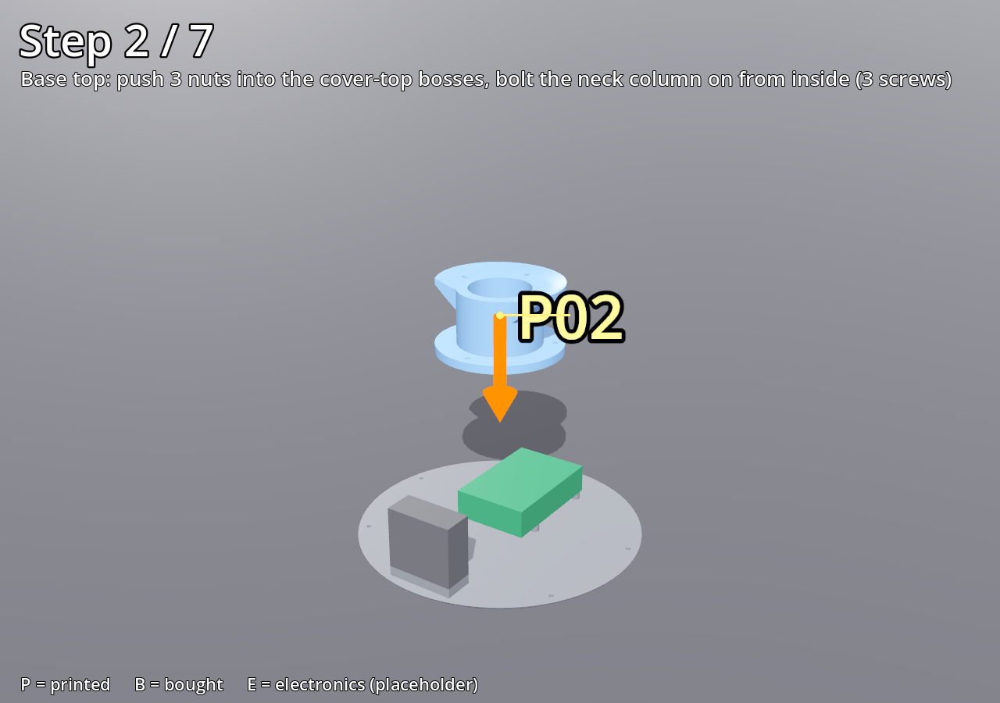
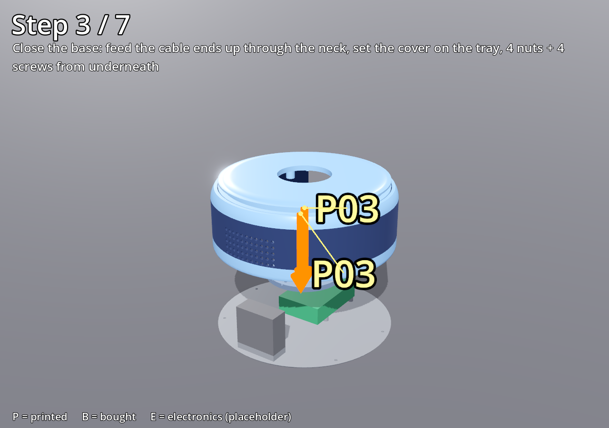
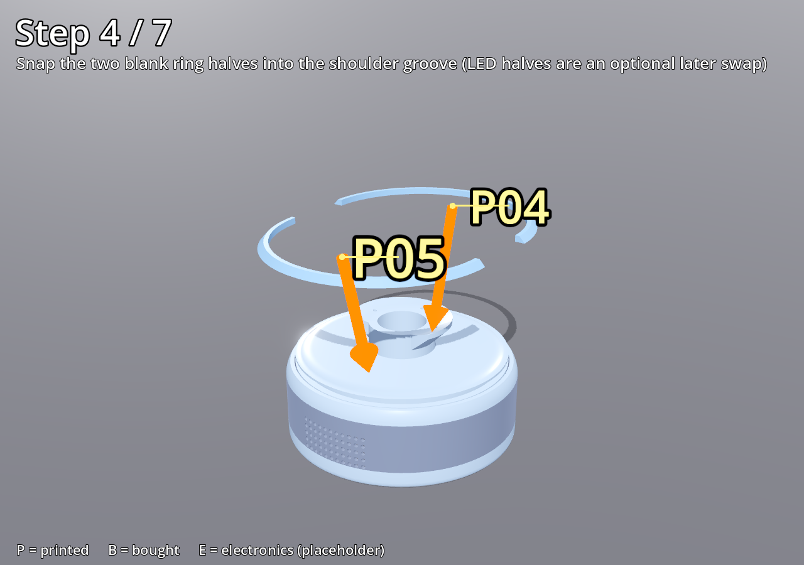
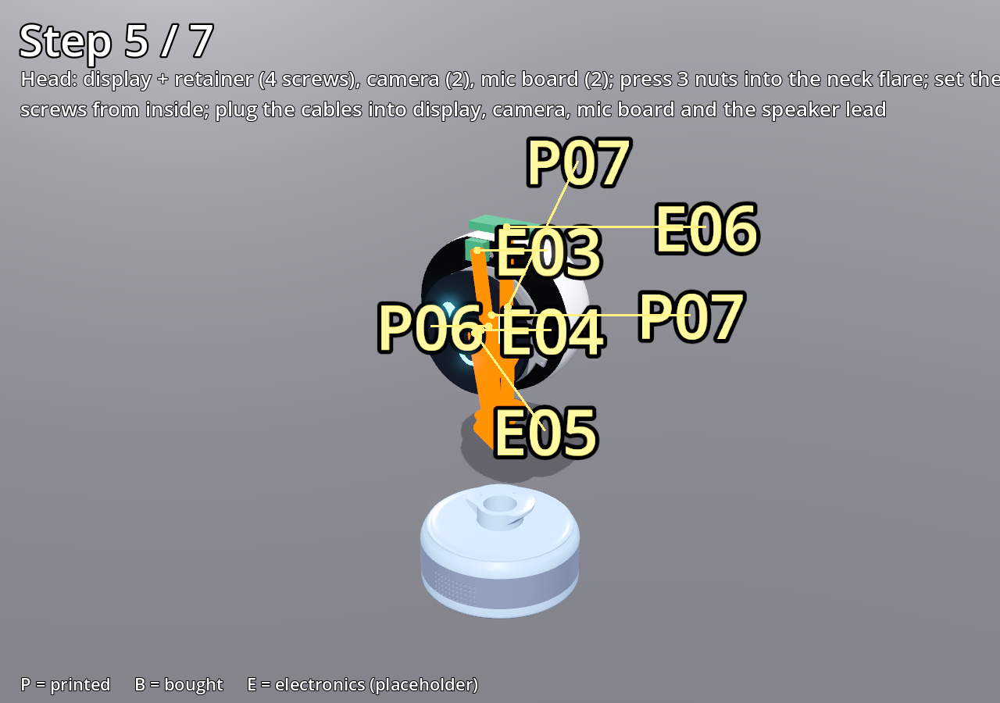
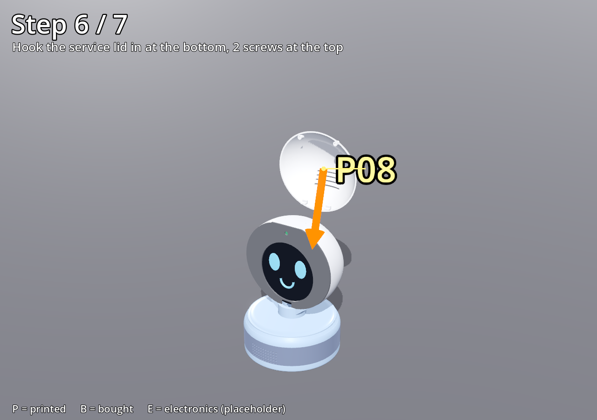
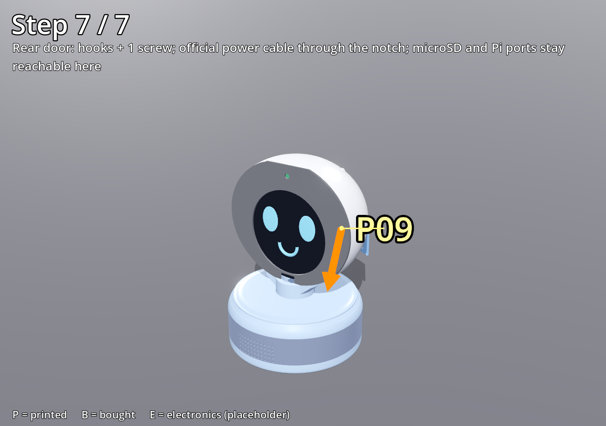

# JARVES Pebble A — beginner assembly guide (R5b draft)

_Draft from CAD R5b. No part has been printed or bought yet, so every fit below is **checked in CAD only**._
_Images are generated by `godot\export_instructions.cmd`. Part numbers match [the parts inventory](../reviews/PEBBLE_PARTS_INVENTORY.md)._

## 1. What you receive (from the print shop)

| ID | Part | Colour (finish C) |
|---|---|---|
| P01 | Tray (base floor) | any — hidden |
| P02 | Neck column | sky blue |
| P03 | Base cover (with navy band printed in) | sky blue + navy |
| P04, P05 | Blank ring halves | sky blue |
| P06 | Display retainer ring | any — hidden |
| P07 | Head body (with dark face ring printed in) | white + dark ring |
| P08 | Head service lid | white |
| P09 | Rear door | sky blue |

Optional: A02/A03 translucent ring halves, only if you later fit the LED ring.

## 2. What you buy (ready-made, plug-in only)

| ID | Item | Notes |
|---|---|---|
| E01 | Raspberry Pi 5 + official Active Cooler + microSD card | flash the card before you start |
| E05/E04 | Waveshare 5″ round HDMI touch display (1080×1080) | comes with its driver board |
| E03 | Raspberry Pi Camera Module 3 (Wide) + **500 mm** Pi 5 camera ribbon (22→15 pin) | the short ribbon in the box is too short |
| E06 | Seeed ReSpeaker Lite (2-mic USB board) | also drives the speaker (on-board 5 W amplifier) |
| E02 | Seeed mono enclosed speaker 4 Ω 5 W for ReSpeaker Lite | **check the lead length** — it must reach from the head to the base (about 35 cm). The plug type is not confirmed yet. |
| — | Slim micro-HDMI → HDMI cable, 50 cm | display video |
| — | 2 × USB cables, 50 cm (USB-A → display touch port, USB-A → USB-C for the mic board) | |
| — | Official Raspberry Pi 27 W USB-C power supply | |
| — | Screw kit: M3×10 (6), M3×12 (10), M3×16 (2), M2.5×6 (6), M2×6 (2), 13 M3 hex nuts | 26 screws in total |
| — | 4 stick-on rubber feet | |

**Tools:** one Phillips screwdriver (#1 and #2 tips), and tweezers or a small flat screwdriver for pushing nuts. No soldering, glue, drilling or cutting.

**Time:** about 1–1½ hours. **Difficulty:** easy–medium. The fiddly parts are pushing the nuts in and threading the cables through the neck.

## 3. Steps

Unplug everything while assembling. Handle boards by their edges.

### Step 1 — Tray

1. Screw the Pi 5 (with its cooler fitted) onto the 4 tray bosses with 4 × M2.5×6. The microSD edge faces the door opening.
2. Set the speaker in its cradle at the front and fix the strap with 1 × M3×10.
3. Plug into the Pi: the micro-HDMI cable, the camera ribbon (contacts toward the board, lock the latch) and the 2 USB cables.
4. Lay the speaker lead next to the other cables.

### Step 2 — Neck on the base cover

1. Turn the base cover (P03) upside down. Slide 3 M3 nuts into the side slots of the 3 bosses around the neck hole.
2. Place the neck column (P02) on the top of the cover. From inside, drive 3 × M3×12 up through the flange into the nuts. Tighten until snug. Do not over-tighten: the parts are plastic.

### Step 3 — Close the base

1. Feed the **5 cable ends** up through the neck, one plug at a time: HDMI, camera ribbon, 2 × USB, speaker lead. The bore is 44 mm and the largest plug is about 25 mm across.
2. Lower the cover onto the tray. Push 4 nuts into the 4 floor boss slots.
3. Turn the base over and drive 4 × M3×12 from underneath. Stick the 4 rubber feet on.

### Step 4 — Ring

Press the two blank ring halves (P04, P05) into the groove on the shoulder until they click.

### Step 5 — Head

1. Lay the head body (P07) face-down on a soft cloth. Drop the display in, with the glass toward the face opening. Fit the retainer ring (P06) with 4 × M3×10.
2. Screw the camera behind its window (2 × M2×6) and the mic board under the crown (2 × M2.5×6).
3. Push 3 nuts into the pockets on top of the neck column, from the bore side.
4. Set the head on the neck. Reach in through the open back and drive 3 × M3×12 down into the neck.
5. Plug in: HDMI and USB to the display board, the ribbon to the camera, USB-C to the mic board, and the speaker lead to the mic board's speaker connector.

### Step 6 — Service lid

Hook the lid (P08) in at the bottom, swing it closed, and fit 2 × M3×16 at the top.

### Step 7 — Rear door and power

Insert the microSD card. Hook the door (P09) in at the bottom and fit 1 × M3×10. Plug the power supply in through the notch.

## 4. Service

| To reach | Open |
|---|---|
| microSD, Pi ports, power | rear door (1 screw) |
| display, camera, mic board, head screws | service lid (2 screws) |
| LED ring / blanks | pop out from outside |
| everything in the base | head off (3 screws), then the 4 screws underneath |

**First power-on:** set a software volume limit before playing loud audio, because USB power is shared (see the review).
