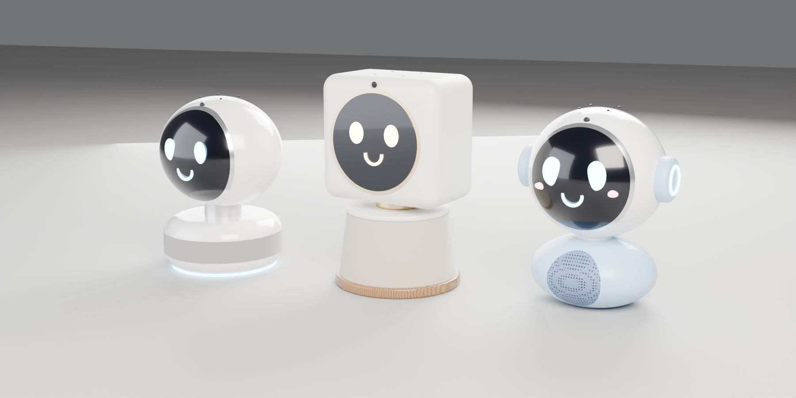
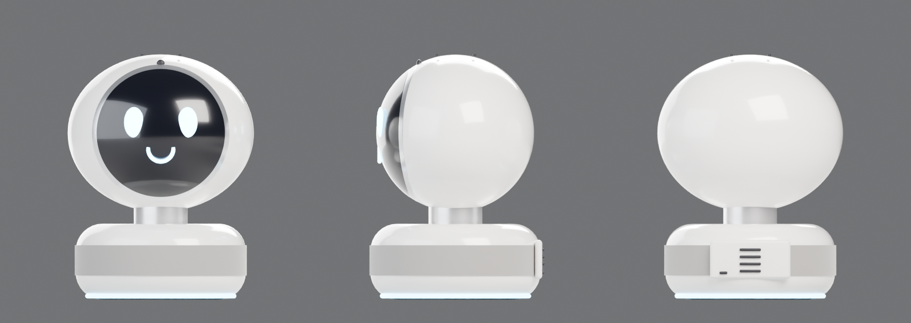
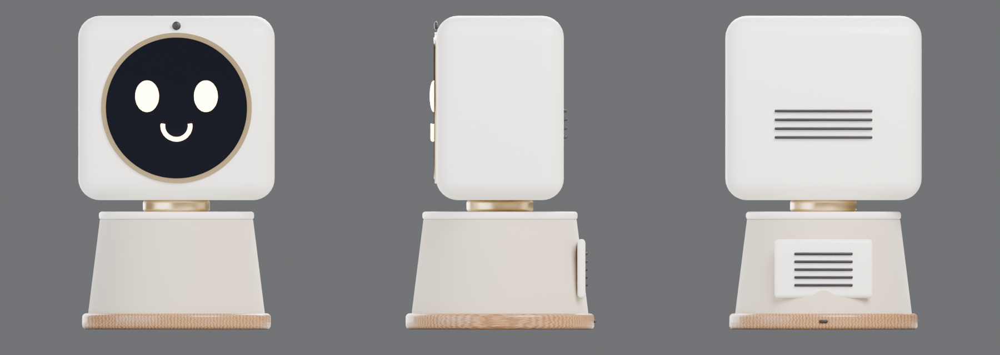
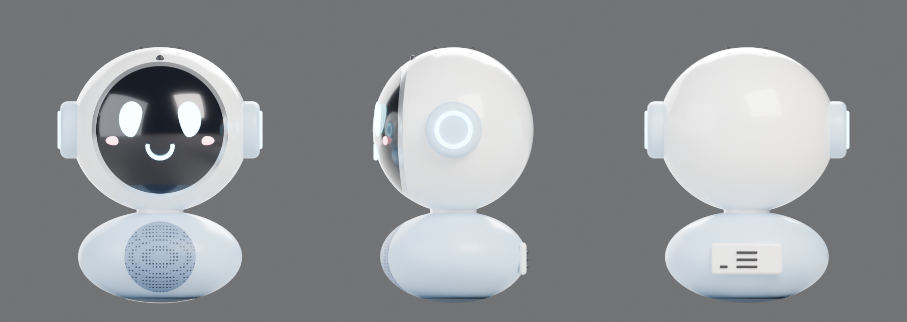
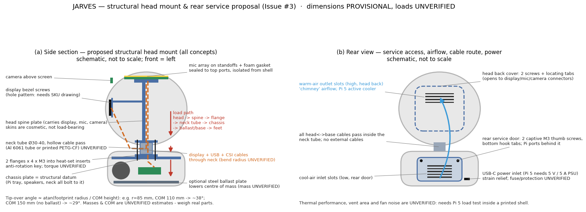

# JARVES S1 design review — Issue #3

**Model:** Claude Opus 5.5 (`claude-opus-5-5`). The user selected it with `/model` for this review. Earlier milestones ran on Sonnet 5.5.
**Status:** review artifacts only. **No CAD/Blender/Godot redesign has been implemented.** Waiting for the user to choose a concept.
**Scope guard:** these are visual concepts plus a mechanical/acoustic analysis. All sizes are approximate and PROVISIONAL. All loads, masses, tolerances and acoustic figures are UNVERIFIED.

Artifacts:
- `design/concepts/concepts_hero.png`: the three concepts side by side, 3/4 view.
- `design/concepts/concept_{A,B,C}_views.png`: orthographic front / side (+X) / rear views for each concept.
- `design/review/head_mount_and_rear_service.png`: structural head-mount section and rear service schematic.
- Generators: `design/concepts/build_concepts.py` (Blender) and `design/review/make_diagrams.py` (matplotlib).

## 1. Review of the current CAD and Godot screenshots

**The head is not connected to the body.** This was measured in FreeCAD on `cad/JARVIS_blockout.FCStd`:
- Head shells lowest point: z = 80.0 mm.
- Body shell top: z = 79.0 mm.
- Minimum distance between them: **1.0 mm**, with zero shared volume.

So the side view's "floating head" impression is accurate. The S1.T01b handoff had already listed "head-body joint/neck not modelled". The head is a plain disc and the body a plain box, so the model reads as a mechanical blockout.

**The rear view has nothing to explain it.** It shows only a plain back cap (`Head_Back`) and a flat plate (`Door_Rear`). There are no fasteners, vents, power inlet or cable route, so the panel has no visible purpose.

**What each part in the screenshots is** (all are box/cylinder *envelopes*, not manufacturer models):

| What you saw | Part name | Status |
|---|---|---|
| Two round grey discs on the body front | `Speaker_L`, `Speaker_R` (grille plates Ø50) | placeholder, PROVISIONAL |
| Two round dark-grey cylinders inside | `Speaker_Driver_L`, `Speaker_Driver_R` (Ø46×25) | envelope, PROVISIONAL (no driver chosen) |
| Large green block in the body (yellow/orange in the Godot shot because it was selected) | `Pi_5` (56×85×20 incl. cooler) | envelope; 85×56 board is public spec, not datasheet-verified |
| Thin grey plate under it | `Pi_Tray` | placeholder |
| **Purple block** | `Reserve_USB_Hub` | **not a device**: a spare-volume reservation |
| Small green block above the display | `Camera_Module` (25×24×12.4) | envelope; size VERIFIED from Raspberry Pi docs |
| Dark slab at the top of the head | `Mic_Array` (108×108×18) | envelope from a retailer figure for the XVF3800, PROVISIONAL |
| Large dark disc | `Display_Module` (Ø148×12) | envelope, PROVISIONAL (no SKU chosen) |
| Black disc, blue dot, small top cylinder | `Screen`, `Camera` (lens), `Mic_Top` (port) | cosmetic placeholders |
| **Not modelled at all** | cables/wiring, connectors, fasteners, standoffs, neck, power inlet/PSU, amplifier, vents, light ring | — |

## 2. Three visual directions

### A — "Pebble": a pearl-white orb on a soft fabric puck

- **Look:** a glossy pearl-white ellipsoid head with a domed black glass face and soft blue eyes. A satin neck collar sits on a rounded puck base with a warm-grey fabric speaker band and a blue light ring at the foot. It stays closest to the reference image and feels calm and premium.
- **Size:** about H275 × W210 × D180 mm, slightly over the provisional W200/D160.
- **Internals fit:** a flat Ø148 display needs a **domed clear window** in front of it. The dome sags about 25 mm, which gives parallax and a "fishbowl" look, and the window is an extra thermoformed or machined part. A **flat-facet face** variant avoids this. The 108 mm mic board must sit about 20 mm below the curved top, with short port tubes. The base holds the Pi and two drivers, about 1.4 L gross.
- **Acoustics:** front- or 360°-firing drivers behind the fabric band. The mics on top of the head are about 180 mm from the drivers, which is good for echo cancellation (AEC). The small sealed base volume limits bass.
- **Manufacturing:** the ellipsoids print well as front/back halves. The glossy finish needs sanding and paint or coating. The fabric band needs a frame.

### B — "Lantern": soft-square head, fabric column, light-wood plinth

- **Look:** a warm matte-white soft-square head with a flat face, brass screen rim and **warm amber** eyes. It sits on a brass collar over an oat-fabric tapered column with a light-wood plinth. It reads like a premium home-audio object and is the least "gadget-like" of the three.
- **Size:** about **H320** × W200 × D135 mm head, base Ø192. It is taller than the provisional H280 and needs your OK.
- **Internals fit:** the **flat face suits a flat display natively**, with no dome. The flat top takes the 108 mm mic board directly under the top panel, giving the shortest port paths. The column gives the most volume, about 2.1 L gross.
- **Acoustics:** the best of the three. A front-firing pair behind the fabric is possible, with an optional passive radiator. The mics are about 200 mm above the drivers.
- **Manufacturing:** the easiest to print and finish (flat-ish panels). The fabric wraps a simple cone. The plinth is real wood or a wood-look print, which is one extra material or process. It is the tallest concept, so tip stability needs ballast.

### C — "Buddy": a character head with ear pods, pastel two-tone

- **Look:** the cutest and most character-like. It has a big white head with a domed face, larger cyan eyes and pink cheeks. Sky-blue ear pods carry status light rings. The low pastel "cushion" body has a perforated grille.
- **Size:** about H285 × **W232** (with ears) × D182 mm.
- **Internals fit:** it needs the same domed window as A. The ears are tempting places for speakers, but drivers there would sit about 60 mm from the mics, which hurts AEC and adds vibration. **Keep the ears cosmetic/LED only.** The cushion base is the tightest volume, about 1.2 L and curved.
- **Acoustics:** the weakest of the three (smallest enclosure, curved grille). Speech is fine, music is limited.
- **Manufacturing:** the most parts and finishes (ears, two-tone paint, dome). The risk is that it reads as a toy rather than premium.

### Comparison

| | A Pebble | B Lantern | C Buddy |
|---|---|---|---|
| Friendly / cute | ●●●● | ●●● | ●●●●● |
| Premium feel | ●●●●● | ●●●●● | ●●● |
| Fits flat Ø148 display | dome or flat facet | **native** | dome |
| Mic board / port path | OK (port tubes) | **best** (flat top) | OK (port tubes) |
| Speaker volume (gross) | ~1.4 L | **~2.1 L** | ~1.2 L |
| Print/finish effort | medium-high (gloss) | **lowest** | highest |
| Envelope vs H280×W200×D160 | slightly over in W/D | **H≈320** | **W≈232** |

**Recommendation:** **A (Pebble)**, using B's engineering choices: a **flat face facet** for the display instead of a deep dome, and a **small flat top cap** for the mic array. That keeps the reference-like, warm, premium look and removes A's two main technical risks. If you prefer an object that looks like home audio and you accept H≈320, **B** is the safest to build and sounds best. C is the most charming, but has the weakest audio and the highest risk of a toy-like finish.

## 3. Structural head mount (all concepts)

- **Principle:** the shells become cosmetic skins. A **head spine plate** carries the display, mic array and camera. A **hollow neck tube** (Ø30–40 mm, aluminium 6061 or printed PETG-CF) bolts to the spine with a top flange and to a **chassis plate** in the base with a bottom flange. Each flange uses 4 × M3 into heat-set inserts, plus an anti-rotation key. The Pi tray, speakers and neck all bolt to the chassis plate, which becomes the structural datum.
- **Load path:** head → spine → top flange → neck tube → bottom flange → chassis → base/ballast → rubber feet.
- **Cables:** everything runs inside the neck tube: display video (micro-HDMI is stiff, so it needs a slim or flexible cable or adapter), USB (mic array, touch) and the CSI camera ribbon (the Pi 5 needs the 22-pin Standard–Mini cable). There are no external cables. A grommet seals the pass-through acoustically.
- **Stability:** tip-over angle ≈ atan(footprint radius / centre-of-mass height). With an 85 mm radius and the COM at 110 mm, that is about 38°. Without ballast the COM is about 150 mm, giving about 29°. An optional steel ballast plate under the chassis lowers the COM.
- **UNVERIFIED:** part masses and COM, flange/tube strength, insert pull-out, screw torque, print tolerances, cable bend radii, display mounting-hole pattern (needs the SKU drawing). Validation: weigh real parts, check COM by hanging, run a printed tilt test at 30°, check insert pull-out on coupons, and test-fit the cables through a printed neck.

## 4. Rear, service, airflow, power

- **Rear service door** (base): 2 captive M3 thumb screws plus bottom hook tabs. The Pi ports sit behind it with the existing 25 mm plug room.
- **Head back cover:** 2 screws plus locating tabs. It opens to the display, mic and camera connectors.
- **Airflow:** a "chimney". Cool air enters through low inlet slots in the rear door, and warm air leaves through high outlet slots in the head back. The Pi 5 keeps its active cooler.
- **Power:** a USB-C inlet at the rear foot with strain relief. The Pi 5 needs a 5 V / 5 A supply. Protection and fusing are UNVERIFIED.
- Thermal performance, vent area and fan noise are **UNVERIFIED** until a Pi 5 load test inside a printed shell.

## 5. Room-scale voice pickup and playback

Facts we don't have: **room size and talking distance are UNKNOWN.** Please state them, for example a 5×7 m room with talkers at 2–5 m. **No far-field performance is promised.** XVF3800 vendor pickup-range claims are UNVERIFIED in our enclosure.

**Mic placement options:**
1. **Top of head, 4-mic circular, horizontal (recommended).** It is the highest point, covers 360°, and is farthest from the speakers.
2. A front-facing linear array above the screen. Better forward gain, but it loses 360° coverage and sits near display and backlight noise.
3. A ring on the base. Worst: close to the speakers and to table reflections.

**Signal processing:** the XVF3800 does on-chip beamforming, AEC, noise suppression and AGC (vendor claim). **AEC needs the playback reference**, so route speaker audio *through* the XVF3800 output, as planned in HARDWARE.md, or provide a loopback.

**Mechanics for acoustics:**
- Ø1–1.5 mm ports aligned to the actual mic positions, with short gasketed port tubes.
- Mic board isolated with foam.
- A separate sealed speaker chamber, with drivers on rubber gaskets.
- No shared air path between speaker and head, so seal the neck grommet.
- Rubber feet to decouple from the table.

**Speaker orientation:**
- **Front-firing pair:** best for speech intelligibility. Recommended for A and B.
- **Up- or down-firing with a dispersion cone:** fills a room evenly, but costs height.
- Ear or side drivers: rejected for C because of mic proximity.

Small 40–50 mm drivers are fine for speech but limited for music in a large room (UNVERIFIED).

**Validation plan, in order and without buying anything yet:**
- **V1:** test the bare array and a powered speaker on Windows in *your* room. Use a fixed phrase list at 1/2/3/5 m, quiet and with the TV at a fixed level. Record WAVs and score the hit rate.
- **V2:** barge-in/AEC test, speaking while music plays at the target level.
- **V3:** repeat part of V1 with a printed head-top port fixture.
- **V4:** speaker chamber test: SPL at 1 m with a phone meter, plus listening and rattle checks.
- **V5:** repeat V1 and V2 in the full assembly.

## 6. Planned changes per layer, after your choice

- **FreeCAD (source of truth):**
  - Replace the Head/Body primitives with the chosen surfaces (revolve/loft).
  - Add the chassis plate, neck tube and flanges, head spine, display and mic mounts, port holes, speaker chamber, and a screwed rear door with vents and the USB-C cutout.
  - Extend `check_layout.py` with a "no floating parts" check (head connected through the neck) and a COM estimate.
  - Update `ASSUMPTIONS.md`.
- **Blender:** the chosen palette and materials, the face placeholder style, and a fix for the smooth-shading gradients on flat faces. Then re-render.
- **Godot:** re-import the `.glb` and update the part lists (spine, neck, chassis). There are no new interactions in this step.
- Technical IDs (`JARVIS_*` files) stay unchanged until a rename is approved.

## 7. Decisions needed from you
1. **Concept:** A, B, C, or the recommended **A with a flat face facet and flat mic cap**. A different palette is also possible.
2. **Envelope:** may the size exceed H280 × W200 × D160 mm? B needs H≈320 and C needs W≈232.
3. **Display SKU** and its mechanical drawing, since the face shape and mount depend on it.
4. **Mic array:** keep the 108 mm XVF3800 USB board, or consider a smaller circular variant (requires its drawing)?
5. **Room** size and typical talking distance, for the acoustic validation targets.
