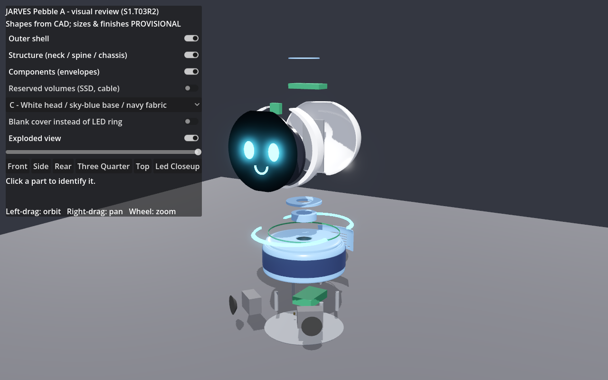

# JARVES S1.T03R3 — LED ring, speaker grille, exploded assembly & service review (Issue #4, round 2)

**Status:** review candidate, waiting for your review. Your decisions are kept: the overall design, the side profile and **finish C**, which is now the default.
**Not covered:**
- No purchases or final part choices.
- No manufacturing release.
- **No physical validation:** strength, fit of real parts, tolerances, heat and sound are untested.

**Models used:**
- Claude Opus 5.5: engineering and design decisions, CAD and Blender, integration, review.
- Claude Sonnet 5.5 subagent: one narrowly scoped Godot task (exploded view, LED/blank swap, screenshot export). I re-checked its work independently.
- Haiku: not used, because no task was simple enough to be worth splitting out.

## Review images (exported automatically)
**Godot viewer:** `godot/previews/r3/`. Regenerate with `godot\export_previews.cmd`.

| View | File |
|---|---|
| Front / side / rear / ¾ / top | [r3_front](../../godot/previews/r3/r3_front.png) · [r3_side](../../godot/previews/r3/r3_side.png) · [r3_rear](../../godot/previews/r3/r3_rear.png) · [r3_3q](../../godot/previews/r3/r3_3q.png) · [r3_top](../../godot/previews/r3/r3_top.png) |
| LED ring close-up / blank cover fitted | [r3_led_closeup](../../godot/previews/r3/r3_led_closeup.png) · [r3_led_blank_closeup](../../godot/previews/r3/r3_led_blank_closeup.png) |
| Exploded ¾ / side / front | [r3_exploded_3q](../../godot/previews/r3/r3_exploded_3q.png) · [r3_exploded_side](../../godot/previews/r3/r3_exploded_side.png) · [r3_exploded_front](../../godot/previews/r3/r3_exploded_front.png) |
| Interior (shell hidden, reserved volumes shown) | [r3_interior](../../godot/previews/r3/r3_interior.png) |
| Finish A / B for comparison only | [r3_finish_A_3q](../../godot/previews/r3/r3_finish_A_3q.png) · [r3_finish_B_3q](../../godot/previews/r3/r3_finish_B_3q.png) |

**Blender renders:** `blender/renders/`: [hero C](../../blender/renders/pebble_r3_hero_C.png) · [rear C](../../blender/renders/pebble_r3_rear_C.png) · [exploded ¾](../../blender/renders/pebble_r3_exploded_3q.png) · [exploded side](../../blender/renders/pebble_r3_exploded_side.png).

These are automatic screenshots of the current model. They are not a substitute for you trying the viewer (`godot\run_viewer.cmd`).

## 1. LED status ring — moved up, removable, with a blank cover
- **Where:** a groove around the **upper shoulder of the base** (z 74–80 mm), above the rear door. It is visible from the front, the sides and above.
- **Parts:**
  - `LED_Diffuser_Front` / `_Back`: two translucent half rings that **snap in from outside**. A closed ring could not pass over the head; halves can be removed without opening the robot.
  - `LED_Strip`: addressable-strip placeholder in the groove bottom.
  - `_LED_Backer`: an internal thickening ring, so the groove doesn't weaken the 3 mm wall.
  - A Ø4 wire hole at the back.
  - `LED_Connector`: a detachable 3-pin connector placed **directly behind the rear door**. Unplug it there; no head removal needed.
- **Blank cover:** `LED_Blank_Front` / `_Back` have identical geometry in opaque base colour. The CAD check confirms they are exact drop-in replacements. In the viewer, use **"Blank cover instead of LED ring"**.
- **UNVERIFIED:** snap-tab retention, diffusion evenness, strip width (about 5 mm assumed), 5 V supply/current and Pi signal level, heat. No LED part chosen.

## 2. Speaker openings — why they looked like wheels, and the fix
- **Cause:**
  - Each speaker was a single Ø46 hole with a flat black 5 mm disc, mounted low and angled ±35°.
  - With the shell or fabric hidden, the two dark discs sat at the bottom like wheels.
  - The interior views also showed the pods as boxes standing on the floor.
- **Fix (in CAD):**
  - Each speaker now gets a **perforated grille window**: 9 × 5 holes of Ø3.5 mm, about 54 × 30 mm. It sits behind the fabric band and is invisible from outside.
  - The drivers are now **cone-shaped envelopes** centred at band height (z 34), each in a sealed pod 60 × 32 × 42 mm.
  - From outside you see only the clean fabric band.
- **Risk:** the pods are small (about 0.06 L each), so bass will be weak. Perforation open area and fabric transparency are acoustically **untested**. Alternative to test later: ready-made mini speaker boxes, or a passive radiator.

## 3. Assembly — parts, fasteners, sequence
**Full table (auto-generated from CAD):** [PEBBLE_PARTS_INVENTORY.md](PEBBLE_PARTS_INVENTORY.md). It lists printed parts, purchased stock parts, electronics placeholders, reserved volumes, alternates, fasteners and the 14-step sequence.

**Short version:**

| Group | Parts |
|---|---|
| **Printed** (PETG suggested) | base floor, 4 bridge posts, 2 speaker pods, bridge plate, 2 neck flanges, base shell, rear door, 2 LED diffuser halves (translucent), 2 blank halves, neck collar, head rear dome, head spine + foot, face bezel, mic cap |
| **Purchased stock** | Ø40×2 aluminium tube, 3 mm tinted acrylic face cover (laser-cut), fabric band, M2.5 brass standoffs |
| **Electronics placeholders** (no SKU) | display + driver, camera, mic board, Pi 5 + cooler, 2 drivers, LED strip, LED connector |
| **Reserved** (not installed) | M.2 HAT+ height, USB-M.2 SSD bay, display cable room |
| **Fasteners** (NOT modelled, all UNVERIFIED) | about 40 M3 screws + heat-set inserts, 4 M2.5 for the Pi, flange set screws, 2 captive door thumb screws, snap tabs for LED halves and face-cover clips, 4 rubber feet |

**Sequence, bottom-up:**
1. Floor, then posts and standoffs.
2. Pi 5, speaker pods, LED connector.
3. Bridge plate, lower flange and aluminium tube.
4. Base shell lowered over the tube and screwed from underneath; band; rear door.
5. LED strip, then diffuser halves (or blank).
6. Collar and top flange.
7. Head rear dome.
8. Spine.
9. Display, camera and mic on the spine.
10. Face bezel with acrylic.
11. Mic cap.

Disassembly is the reverse.

## 4. Engineering review (geometry-checked only)
- **Neck mounting:**
  - The load path is continuous and checked by CAD contact tests: head floor → top flange → aluminium tube → lower flange → bridge → 4 posts → floor.
  - **Concerns:**
    - The head seat ring that rests on the flange is small (about r 21–30 mm), so wobble and screw pull-out are risks.
    - Set screws on a round tube can slip under twisting.
    - A head grabbed by a child puts its leverage on the flange screws.
  - **Recommendations:**
    - File a flat, or use a clamp collar, for anti-rotation.
    - Use a larger seat adapter ring, or a deeper seat.
    - Print the flanges flat, with screws into heat-set inserts.
  - **Tests needed:** insert pull-out coupons, a printed neck section tug and twist test, a 30° tilt test with real masses.
- **Cable routing:**
  - Everything between head and base passes inside the Ø40×2 tube (ID 36): display video, touch USB, mic USB, camera ribbon, speaker wires and the LED is in the base.
  - **Risk:** a full-size HDMI plug (about 22 × 12 mm overmould) only just passes, so route it first or use a slim cable.
  - The camera ribbon length (about 30 cm or more) and the bend room are **UNVERIFIED**.
  - Add strain relief (clips) at both ends of the tube and a grommet at the head floor.
- **Rear service access:** the rear door (2 thumb screws) gives access to:
  - the Pi ports (29 mm plug room);
  - the USB-C power inlet opening;
  - the **LED connector**;
  - the reserved SSD bay.

  The Pi's microSD slot faces forward under the bridge and is **not reachable**. Plan to boot from USB/SSD or update over the network, or remove the base shell to swap the card.
- **Printability:**
  - Every printed part fits a 220 × 220 bed. The largest are the rear dome (215 × 184 × 107) and the base shell (Ø210).
  - **Orientations:**
    - face bezel: face-down;
    - rear dome: open side down;
    - base shell: top-down, so the LED groove prints as a short bridge;
    - flat plates and flanges: flat;
    - LED halves: flat.
  - The posts print upright, which is weak along their layers; consider brass or aluminium standoffs instead.
  - Fallback for a 180 mm bed: split the head and base shells at x = 0, with pins and screws (not modelled).
  - Shell screw bosses, ribs, snap tabs and fillets are **not modelled yet**.

## 5. Checks actually run

| Check | Result |
|---|---|
| `freecadcmd cad\smoke_test.py` | **PASS**: blockout + Pebble, with regressions |
| `freecadcmd cad\check_pebble.py` | **PASS**: validity, containment, collisions, 16 load-path contacts, LED connector reachable through the rear door, blank cover = exact drop-in, 220 mm bed; overall **W215 × D218.5 × H292 mm** |
| `blender -b --python blender\smoke_blender.py` | **PASS**: 44 parts vs CAD manifest, worst bounding box 0.28 mm, Godot assets in sync, review renders present |
| `godot\check_viewer.cmd` | **PASS**, exit 0: 44 parts, toggles, picking, finishes, LED/blank swap, explode within 0.000 mm and restore |
| `godot\export_previews.cmd` | 13/13 images present; exits 1 if any is missing |

## 6. Known issues for your review
1. The LED glow in Godot is a visual effect only; real brightness and diffusion are unknown.
2. The viewer's title still says "S1.T03R2" (cosmetic).
3. The R2 images (`godot/previews/pebble_*.png`, `blender/renders/pebble_{front,side,rear,interior,finish_*}.png`) are from the **previous round**, before the LED and grille changes. They are kept as history, not current.
4. Screws, bosses, snap tabs and rubber feet appear only in the inventory, not in the 3D model.
