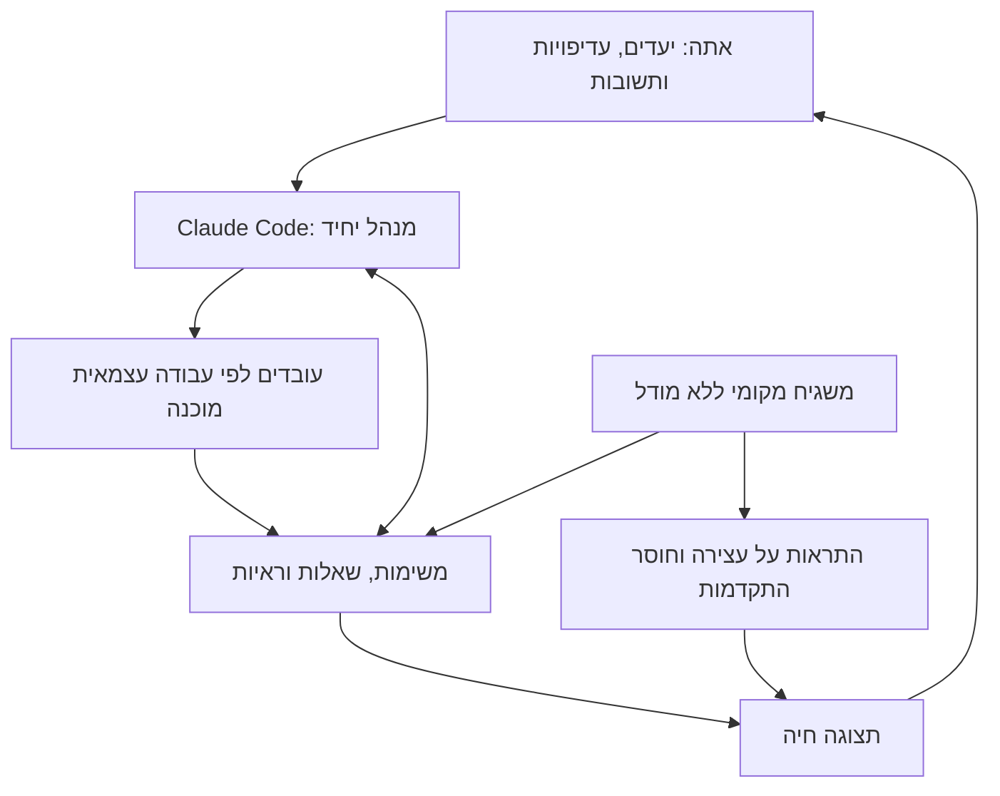
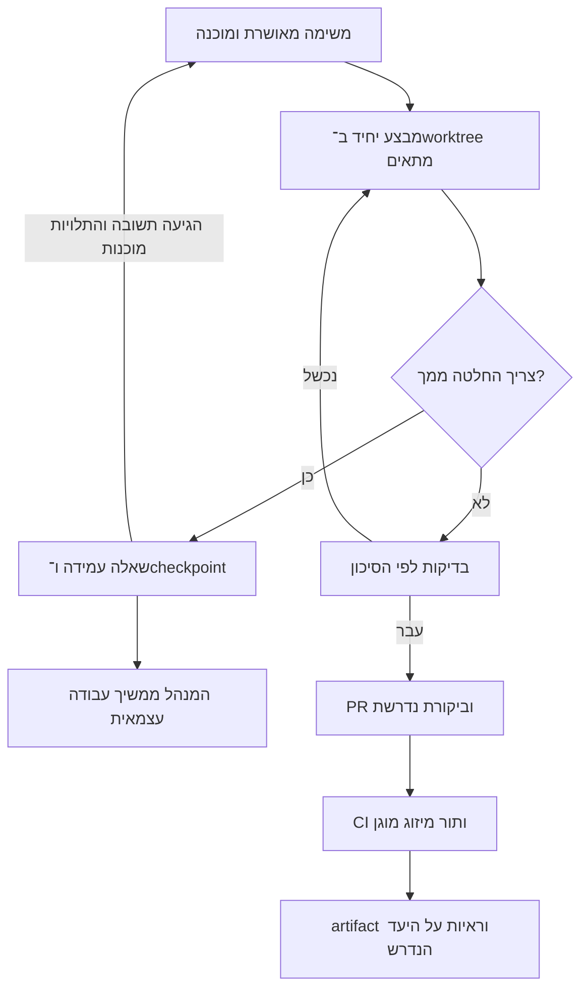
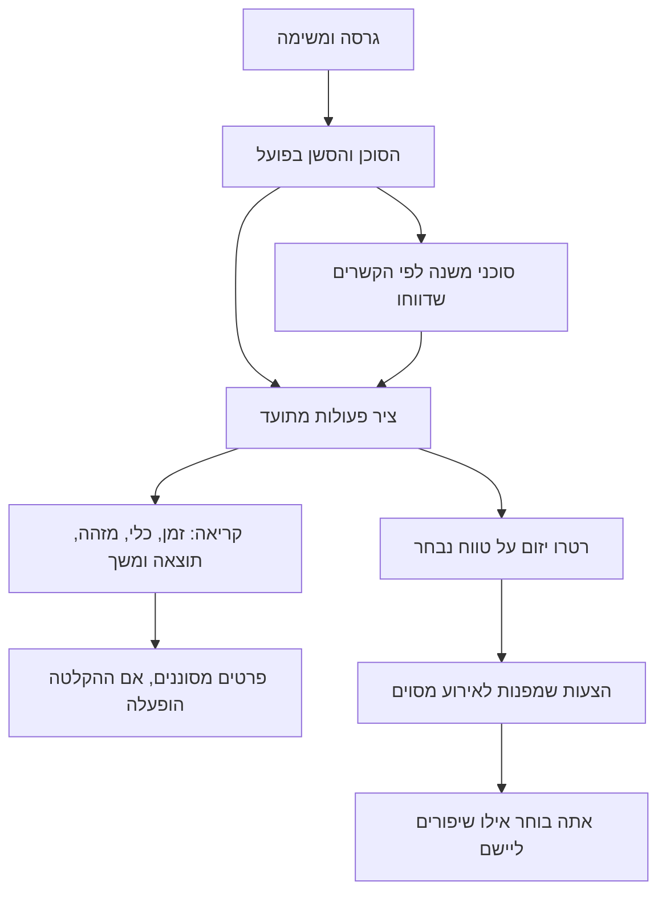

# איך מערכת העבודה תיראה עבורך

31 באוקטובר 2026. תיאור חבילת #712 וגבולות היכולת; מסמך זה אינו הוכחה
למיזוג, להתקנה במחשב או לבדיקת סוכנים אמיתיים.
החוזה המחייב: [OPERATING_MODEL](OPERATING_MODEL.md). הפעלה: [SETUP](SETUP.md).

## מנהל אחד ולוח אחד

אתה ממשיך לדבר עם Claude Code. הוא מפרק משימות, מקצה עבודה, בודק תוצאות
ומעדכן מצב. התצוגה היא חלון למצב העבודה, ולא מנהל AI נוסף.
Codex ו־OpenCode הם כלי ביצוע נוספים כשאתה מבקש כלי ומודל מסוימים.



GitHub מחזיק קוד, issues, PRs ו־CI. הרישום המקומי מחזיק עבודה, החלטות
וראיות. לא מעתיקים את אותו אחוז השלמה ל־NOW, ל־HANDOFF ולעשרה קובצי STATE.
הסוכנים מעדכנים את המצב כחלק מהעבודה; לא אמורה להיווצר לך עבודת דיווח נוספת.

## ביקורת ה־overkill

רישום עמיד נחוץ כדי ששאלה, checkpoint או בדיקה שלא בוצעה לא ייעלמו בין
סשנים. משגיח נפרד נחוץ כי המנהל לא יכול לדווח על מותו שלו. לעומת זאת,
אין צורך להוסיף מנוע orchestration כאשר יש subagents ומתאמי ספקים קיימים.

| נושא | הבחירה הפשוטה | מה לא צריך כרגע |
|---|---|---|
| ניהול | Claude Code וה־subagents הטבעיים | מנהל LLM נוסף, LangGraph או Temporal |
| עובדים | עובד אחד; מוסיפים כשיש עבודה עצמאית | מספר קבוע שחייב להיות עסוק |
| QA | המבצע בודק; ביקורת עצמאית לפי סיכון | סוכן QA קבוע לכל שינוי קטן |
| מצב | SQLite מקומי ותצוגה אחת | Redis, שירות ענן ותורי מסרים נוספים |
| כלים חיצוניים | ממשק agents הקיים ובחירת מודל לבקשה | launcher ו־registry חדשים |
| drill-down | יומן פעולות באותו מסד, בפריסה לפי הצורך | פלטפורמת tracing נוספת |
| שיפור תהליך | רטרו יזום על ריצה נבחרת | שכתוב skills אוטומטי לאחר כל משימה |

גם הבחירה הזאת דורשת hooks, הרשאות ותהליכי רקע. לכן מתחילים בתרחיש אחד
מקצה לקצה, ולא מפעילים את כל תוכנית הגרסאות בבת אחת. מודדים זמן עד שינוי
עובד ומותקן, באגים שחזרו או ברחו מבדיקות, הרצות CI חוזרות וזמן שנדרש ממך.
מספר סוכנים עסוקים או PRs אינו מדד הצלחה, ואין הבטחה לאפס באגים.

## יום עבודה טיפוסי

אתה אומר: ״תמשיך בגרסה הנוכחית ובמקביל סגור את תקלות ההתקנה. אני כאן
לשאלות״. המנהל בוחר משימות מאושרות שאינן תלויות זו בזו ומציג מה פעיל ומה חסום.
באגים, תרחיש הגרסה ובדיקות הם תפקידים; אין חובה לאייש כל אחד בסוכן נפרד.
לא מקצים לשני עובדים אותו חלון Windows, טלפון או תיקיית כתיבה.

בתצוגה הראשית רואים משימה, בעלות, עדכון והתקדמות אחרונים, חסימה והצעד הבא.
בתוכנית הגרסאות רואים את כל הדרישות, ובפתיחת פריט את קריטריוני הקבלה והראיות.
המונים בתמונת המצב מובילים לרשימה המתאימה. בתוכנית בוחרים גרסה, מצב או
חיפוש; סעיפי הגרסאות נפתחים לפי הצורך. בחלון משימה אפשר לעבור ישירות
להיסטוריה שלה או של הסוכן. גם במסך צר כל ארבע הלשוניות נגישות בתחתית.
94 הדרישות שבמיפוי הן scope ולא הרשאה גורפת לביצוע; 18 חיבורים ל־issues
מפורטים עדיין חסרים ומסומנים. אופציונלי אינו מנפח את מכנה השלמת החובה.



בבאג: שחזור ובדיקת רגרסיה. ב־UI: תרחיש בדפדפן/אפליקציה לפי הקריטריונים.
בנתיב רגיש: הביקורת העצמאית הקיימת. בטלפון/רכב: בדיקה ביעד האמיתי, עד אז
הוא לא מאומת שם. בדיקות ממוקדות בזמן העבודה, prepush לפני העלאה ו־CI רחב
בנקודה המתאימה; אין צורך להריץ הכל אחרי כל שורת קוד.

מפרידים בין קוד שקיים, אימות שבוצע, artifact שנמסר וראיות לקריטריונים.
הראיות קשורות ל־revision מסוים. קוד חדש לא יורש אוטומטית V ירוק מקוד קודם.

## כשאתה ליד המחשב וכשאתה הולך

במצב ״אני כאן״ מקבלים שאלות קצרות עם אפשרויות ותשובה חופשית ואפשר לענות
ברצף. אין מגבלת פעם ביום הישנה. ב״להמשיך בלעדיי״ שומרים שאלות ו־checkpoints,
ועוצרים רק את העבודה שתלויה בתשובה. שתיקה אינה אישור.

```mermaid
sequenceDiagram
    participant U as אתה
    participant M as המנהל
    participant L as הלוח
    participant W as עובד
    U->>M: תמשיך; אני לא זמין כרגע
    M->>W: משימה א׳
    W->>L: שאלה חסרה ו־checkpoint
    W-->>M: א׳ ממתינה ולא הושלמה
    M->>W: משימה ב׳ העצמאית והמאושרת
    U->>L: תשובה לשאלה א׳
    L-->>M: א׳ שוב מוכנה למחזור העבודה הבא
    M->>W: חוזרים לא׳ עם ההחלטה וה־checkpoint
```

תשובה מחזירה משימה לתור; היא לא מעירה אוטומטית סשן Claude שמת. במצב כזה
המשגיח מציג את העצירה, והתשובה נשמרת לסשן הבא. כשהכל באמת חסום, מראים זאת
במקום להמציא עבודה, לדלג על החסימה או להפעיל מחדש כותב שמצבו אינו ברור.

## בקשה לכלי ולמודל מסוימים

לדוגמה: ״את הביקורת על T תעשה ב־Claude Code עם Opus״, או ״את תיקון T תריץ
ב־Codex עם המודל שבחרתי״. כלי ומודל הן בחירות נפרדות; אין החלפה אוטומטית
על ידי המנהל כדי שהפקודה תצליח.

```powershell
jarvis agents start claude jarves "Review task T; follow repository rules" --model claude-opus-5-5 --json
jarvis agents start codex jarves "Implement task T; follow repository rules" --model YOUR_CODEX_MODEL --json
jarvis agents start opencode jarves "Implement task T" --model PROVIDER/MODEL --json
```

אלה דוגמאות למנהל, לא פקודות שתצטרך להקליד בכל משימה. הוא משתמש בממשק
agents הקיים ל־start/ask/tell/status ובאותו רישום עבודה להחלטות וראיות.
העובד חייב להחזיק במשימה המדויקת לפני שינוי קוד; כשל claim הוא חסימה.
סנכרון אוטומטי מלא בין כל אירוע Orchestrator לבין בעלות המשימות הוא חלק מ־#715.

האישור הקיים נשמר. `--yes` מותר למנהל רק כשיש בקשת הפעלה מפורשת ממך
לאותה משימה, כלי ומודל, ולא עבור בחירה אוטומטית או טקסט של סוכן.
OpenCode בכל מקרה שומר על אישור מלא לכל prompt ועל בדיקות המודל וההגדרות.
בחירה לסשן אינה משנה את ברירת המחדל הגלובלית. עלות OpenCode אינה נמדדת
לסכום אמין, ולכן לא מבטיחים לו תקרת דולר או עבודה ללא השגחה במדיניות הנוכחית.

השדה `requested_model` הוא בקשה, לא הוכחת מודל אפקטיבי. לכלי ספק עשוי להיות
fallback שהוגדר אצלך; אין טענה שהמודל אומת בלי אירוע שמאשר זאת.
הפעלת ספק דרך agents מחייבת Core וחיבור זמין. Claude כמנהל והלוח המקומי
יכולים להמשיך בלעדיו; הפעלה חיצונית לא יכולה להתחזות להצלחה כשהחיבור חסר.

## Drill-down: מתוכנית ועד קריאת כלי



בכרטיס הסוכן פותחים את ״ציר פעולות והיסטוריה״. מסננים לפי סוכן/משימה וטווח,
פותחים פעולה, עוצרים את העדכון החי כדי לנתח, וטוענים אירועים קודמים.
אפשר לבחור טווח תאריך ושעה מדויק; שניית הסיום כלולה. טווח מדויק ודפדוף
לעבר מקפיאים את התצוגה; חזרה לעדכון חי מחזירה טווח יחסי. פתיחת פעולה
מציגה סוכן, כלי, זמן, משך ופרטים שנקלטו, עם JSON טכני מקופל להעמקה.
העבר הוא מה שתועד; ההווה הוא עדכונים שנקלטים; העתיד הוא תוכנית המשימות,
לא קריאות כלים שטרם קרו.

ברירת המחדל שומרת metadata של אירועי lifecycle וכלים. אפשר להפעיל במפורש
גם פרטי כלי מסוננים מכאן והלאה; לא משחזרים בדיעבד קלט ופלט שלא נשמרו.
נשמרים עד שבעה ימים או 20,000 אירועים באותו מסד מקומי, בלי פלטפורמת tracing
נוספת. יצוא לטווח נבחר מכיל עד 5,000 אירועים ומסומן אם נחתך.

ה־hooks הטבעיים קולטים Pre/Post/Failure כשנשלחו בפועל. אירוע גדול מדי או
חסר אינו מומצא. מתאמי הכלים החיצוניים מצרפים את ציר הזמן המנורמל הקיים;
כשיש בו רק תקציר, הכיסוי חלקי ולא מוצג כקלט/פלט מלא לכל קריאה. קשר סוכן
משנה הוא קשר מדווח או שיוך לסשן, ולא הבטחה לשחזור כל עץ הורים שהיה בעבר.
הרחבת הכיסוי המלא לכל ספק חייבת להיבדק מול הכלי המותקן במסגרת #715.

## הפעלת skills-retro ביוזמתך

כפתור ״הכן ל־/retro״ יוצר קובץ מקומי של הטווח שנבחר ובקשה להעתקה לסוכן.
כפתור ההעתקה מעתיק את הבקשה; אם הגישה ללוח אינה זמינה הטקסט מסומן להעתקה ידנית.
הוא לא מפעיל מודל, מתקין skill או משנה קוד/כללים. כש־`/retro` מותקן בסוכן,
אתה מפעיל את הבקשה המוכנה. על הניתוח להפנות למזהי אירועים ולציין הקשר חסר,
ולא להמציא לקחים כלליים כדי למלא רשימה. בחירת שינוי היא פעולה נפרדת שלך.

נבדק המקור של Matt Pocock ב־commit `a496f5513d4a4cf889bc48e189e579f4b0bdf6aa`:
ה־skill מופעל על ידי המשתמש ותלוי ב־`writing-for-agents`. לא הותקנו כאן skills
במחשב שלך. קלטי כלים עשויים להיות רגישים: הם מקומיים, מסוננים וטעונים
בדיקה לפני שיתוף; אין העלאה אוטומטית ל־GitHub או לספק מודל.

## משגיח חיצוני ומשימת ההמשך

המשגיח אינו AI. הוא מבדיל בין חוסר עבודה מוכנה, המתנה להחלטה וסוכן לא
מעודכן. הוא מפעיל מחדש רק את תהליך התצוגה שלו, בתקציב מוגבל. Task Scheduler
אמור להחזיר את המשגיח עצמו אחרי כשל; זה דורש התקנה ובדיקה במחשב.
הוא לא מחייה סוכן אוטומטית ולא מבטיח עבודה לילית רציפה לפני אימות היכולת.

הוכנה [משימה #715](https://github.com/Jarvis-igerman-ai/jarves/issues/715)
כדי ש־JARVES Orchestrator יוכל להיות המנהל במקום Claude, מעל אותו ledger,
inbox ומתאמים. מנהל אחד בכל פעם, בלי מסד משימות שני ובלי הרצות כפולות.
זו משימת המשך מוכנה, לא יכולת שסומנה כהופעלה.

לפי בקשתך, בדיקת המחשב תקרה אחרי המיזוג: dry-run של התאמת ההוראות, עובד
אחד, שאלה, התקדמות במשימה עצמאית, תשובה וחזרה ל־checkpoint. אחר כך כלי
ומודל אמיתיים, תיעוד פעולה והתאוששות המשגיח. רק אז מרחיבים שימוש.

## טייס אוטומטי (בטא, כבוי כברירת מחדל)

אחרי שאתם מפעילים אותו ונותנים הרשאת התחלה מוגבלת בזמן, הקוד שבתוך המשגיח מתחיל
עובד כשנתיב ריק ויש משימה מוכנה. עובד תקוע מופעל מחדש פעם אחת; בקיפאון שני
המשימה נחסמת, מופיעה התראה והנתיב עובר למשימה הבאה. סשן שלא הוא התחיל, והמתנה
לאישור כלי, רק מתריעים: מעל עשר דקות תגיע התראה אחת, ואתם מאשרים או דוחים בחלון.

בקשת מיזוג רגישה (Tier R) מקבלת משימת ביקורת של Opus ולא ממוזגת אוטומטית.
בדיקת בטא רצה פעם ביום, ובדיקות ידניות מגיעות אליכם כפריט שממתין רק למשימה שלו.
הטייס לא ממזג, לא מתייג גרסה ולא מאשר היקף מיובא. הפעלה אמיתית טרם נבדקה במחשב.
עצירה מיידית: jarvis workflow autopilot stop.

## מקורות

- [Claude Code CLI](https://code.claude.com/docs/en/cli-reference): בחירת מודל והפעלת סשן.
- [Codex App Server](https://developers.openai.com/codex/app-server): threads, turns, מודלים ואירועי אישור.
- [OpenCode Server](https://docs.opencode.ai/docs/server/): סשנים, הודעות ומודל בבקשה.
- [AI Hero /retro](https://www.aihero.dev/skills-retro): רטרו יזום והצעות לשיפור סביבת העבודה.
- [מקור ה־skill שנבדק](https://github.com/mattpocock/skills/blob/a496f5513d4a4cf889bc48e189e579f4b0bdf6aa/skills/engineering/retro/SKILL.md).
